  <picture>
    <source media="(prefers-color-scheme: dark)" srcset="./assets/banner-dark.svg" />
    <source media="(prefers-color-scheme: light)" srcset="./assets/banner-light.svg" />
    
  </picture>

  <picture>
    <source media="(prefers-color-scheme: dark)" srcset="https://readme-typing-svg.demolab.com?font=JetBrains+Mono&weight=500&size=15&duration=3200&pause=1100&color=38BDF8&center=true&vCenter=true&width=760&height=36&lines=Building+resilient+REST+APIs+with+FastAPI+%26+Spring+Boot+3;Orchestrating+Medallion+ETL+pipelines+with+Airflow+%26+PySpark;Designing+async+event-driven+systems+with+RabbitMQ+%26+Docker;Clean+architecture+%C2%B7+Automated+testing+%C2%B7+Scalable+backend" />
    <source media="(prefers-color-scheme: light)" srcset="https://readme-typing-svg.demolab.com?font=JetBrains+Mono&weight=500&size=15&duration=3200&pause=1100&color=0284C7&center=true&vCenter=true&width=760&height=36&lines=Building+resilient+REST+APIs+with+FastAPI+%26+Spring+Boot+3;Orchestrating+Medallion+ETL+pipelines+with+Airflow+%26+PySpark;Designing+async+event-driven+systems+with+RabbitMQ+%26+Docker;Clean+architecture+%C2%B7+Automated+testing+%C2%B7+Scalable+backend" />
    
  </picture>

<a href="https://www.linkedin.com/in/thiagosantiagomelo/" target="_blank" rel="noopener noreferrer"><picture><source media="(prefers-color-scheme: dark)" srcset="./assets/btn-linkedin-dark.svg" /><source media="(prefers-color-scheme: light)" srcset="./assets/btn-linkedin-light.svg" /></picture></a>&nbsp;
<a href="mailto:thiagosantiagomelo@gmail.com"><picture><source media="(prefers-color-scheme: dark)" srcset="./assets/btn-email-dark.svg" /><source media="(prefers-color-scheme: light)" srcset="./assets/btn-email-light.svg" /></picture></a>&nbsp;
<a href="https://github.com/thiagosant/thiagosant/blob/main/README.pt-BR.md"><picture><source media="(prefers-color-scheme: dark)" srcset="./assets/btn-lang-pt-dark.svg" /><source media="(prefers-color-scheme: light)" srcset="./assets/btn-lang-pt-light.svg" /></picture></a>

  <picture>
    <source media="(prefers-color-scheme: dark)" srcset="./assets/divider-dark.svg" />
    <source media="(prefers-color-scheme: light)" srcset="./assets/divider-light.svg" />
    
  </picture>

## About

Software engineer focused on **Backend Systems** and **Data Engineering**, building decoupled microservices, event-driven workflows, and idempotent ETL pipelines. Hands-on with **Python**, **Java 21**, **Spring Boot 3**, **Apache Airflow**, **PySpark**, **RabbitMQ**, and **Docker**.

  <picture>
    <source media="(prefers-color-scheme: dark)" srcset="./assets/focus-dark.svg" />
    <source media="(prefers-color-scheme: light)" srcset="./assets/focus-light.svg" />
    
  </picture>

  <picture>
    <source media="(prefers-color-scheme: dark)" srcset="./assets/divider-dark.svg" />
    <source media="(prefers-color-scheme: light)" srcset="./assets/divider-light.svg" />
    
  </picture>

## Featured Projects

<table>
<tr>
<td width="50%" valign="top">

### [breweries-case](https://github.com/thiagosant/breweries-case)
 

`Python` · `Apache Airflow` · `PySpark` · `Docker` · `Pytest`

Idempotent ETL data pipeline implementing the **Medallion Architecture** (*Bronze / Silver / Gold*) over the Open Brewery DB API, orchestrated with Airflow, stored as partitioned Parquet, and validated with unit tests.

</td>
<td width="50%" valign="top">

### [async_notification_system](https://github.com/thiagosant/async_notification_system)
 

`Python` · `FastAPI` · `RabbitMQ` · `Docker` · `Pytest`

Decoupled asynchronous notification microservice powered by **FastAPI**, **aio-pika** (RabbitMQ), Pydantic, and Loguru, managing lifecycle states (`PENDING`, `SENT`, `FAILED`) with full container orchestration and async tests.

</td>
</tr>
<tr>
<td width="50%" valign="top">

### [workshop-springboot3-jpa](https://github.com/thiagosant/workshop-springboot3-jpa)
 

`Java 21` · `Spring Boot 3` · `Spring Data JPA` · `Maven`

Layered RESTful API built with **Java 21** and **Spring Boot 3**, applying clean domain modeling, relational persistence via JPA/Hibernate, service abstractions, and structured exception handling.

</td>
<td width="50%" valign="top">

### [springboot-mongodb](https://github.com/thiagosant/springboot-mongodb)
 

`Java 21` · `Spring Boot 3` · `MongoDB` · `Maven`

Document-oriented RESTful backend built with **Spring Boot 3** and **Spring Data MongoDB**, exploring NoSQL schema modeling, DTO projections, custom repository queries, and clean error responses.

</td>
</tr>
</table>

  <picture>
    <source media="(prefers-color-scheme: dark)" srcset="./assets/divider-dark.svg" />
    <source media="(prefers-color-scheme: light)" srcset="./assets/divider-light.svg" />
    
  </picture>

## Tech Stack

| Domain | Technologies |
| :--- | :--- |
| **Languages** |     |
| **Backend & Messaging** |      |
| **Data Engineering** |     |
| **DevOps & Tooling** |    |

  <picture>
    <source media="(prefers-color-scheme: dark)" srcset="./assets/divider-dark.svg" />
    <source media="(prefers-color-scheme: light)" srcset="./assets/divider-light.svg" />
    
  </picture>

## GitHub Overview & Live Activity

  <picture>
    <source media="(prefers-color-scheme: dark)" srcset="https://github-readme-stats.vercel.app/api/top-langs/?username=thiagosant&layout=compact&langs_count=6&card_width=520&bg_color=0d1117&border_color=30363d&title_color=38bdf8&text_color=c9d1d9" />
    <source media="(prefers-color-scheme: light)" srcset="https://github-readme-stats.vercel.app/api/top-langs/?username=thiagosant&layout=compact&langs_count=6&card_width=520&bg_color=ffffff&border_color=d0d7de&title_color=0284c7&text_color=1f2328" />
    
  </picture>

 

  <picture>
    <source media="(prefers-color-scheme: dark)" srcset="https://github-readme-activity-graph.vercel.app/graph?username=thiagosant&bg_color=0d1117&color=8b949e&line=38bdf8&point=818cf8&area=true&area_color=38bdf8&hide_border=true&radius=12&custom_title=Contribution%20Activity" />
    <source media="(prefers-color-scheme: light)" srcset="https://github-readme-activity-graph.vercel.app/graph?username=thiagosant&bg_color=ffffff&color=57606a&line=0284c7&point=4f46e5&area=true&area_color=0284c7&hide_border=true&radius=12&custom_title=Contribution%20Activity" />
    
  </picture>

 

  <picture>
    <source media="(prefers-color-scheme: dark)" srcset="https://raw.githubusercontent.com/thiagosant/thiagosant/output/github-contribution-grid-snake-dark.svg" />
    <source media="(prefers-color-scheme: light)" srcset="https://raw.githubusercontent.com/thiagosant/thiagosant/output/github-contribution-grid-snake.svg" />
    
  </picture>

  Open to backend engineering, distributed systems, and data pipeline opportunities — reach out via <a href="https://www.linkedin.com/in/thiagosantiagomelo/">LinkedIn</a> or <a href="mailto:thiagosantiagomelo@gmail.com">Email</a>.

  <picture>
    <source media="(prefers-color-scheme: dark)" srcset="./assets/footer-dark.svg" />
    <source media="(prefers-color-scheme: light)" srcset="./assets/footer-light.svg" />
    
  </picture>

