  <picture>
    <source media="(prefers-color-scheme: dark)" srcset="./assets/banner-pt-dark.svg" />
    <source media="(prefers-color-scheme: light)" srcset="./assets/banner-pt-light.svg" />
    
  </picture>

  <picture>
    <source media="(prefers-color-scheme: dark)" srcset="https://readme-typing-svg.demolab.com?font=JetBrains+Mono&weight=500&size=15&duration=3200&pause=1100&color=38BDF8&center=true&vCenter=true&width=760&height=36&lines=Construindo+APIs+REST+resilientes+com+FastAPI+e+Spring+Boot+3;Orquestrando+pipelines+ETL+Medalh%C3%A3o+com+Airflow+e+PySpark;Projetando+sistemas+ass%C3%ADncronos+com+RabbitMQ+e+Docker;Arquitetura+limpa+%C2%B7+Testes+automatizados+%C2%B7+Backend+escal%C3%A1vel" />
    <source media="(prefers-color-scheme: light)" srcset="https://readme-typing-svg.demolab.com?font=JetBrains+Mono&weight=500&size=15&duration=3200&pause=1100&color=0284C7&center=true&vCenter=true&width=760&height=36&lines=Construindo+APIs+REST+resilientes+com+FastAPI+e+Spring+Boot+3;Orquestrando+pipelines+ETL+Medalh%C3%A3o+com+Airflow+e+PySpark;Projetando+sistemas+ass%C3%ADncronos+com+RabbitMQ+e+Docker;Arquitetura+limpa+%C2%B7+Testes+automatizados+%C2%B7+Backend+escal%C3%A1vel" />
    
  </picture>

<a href="https://www.linkedin.com/in/thiagosantiagomelo/" target="_blank" rel="noopener noreferrer"><picture><source media="(prefers-color-scheme: dark)" srcset="./assets/btn-linkedin-dark.svg" /><source media="(prefers-color-scheme: light)" srcset="./assets/btn-linkedin-light.svg" /></picture></a>&nbsp;
<a href="mailto:thiagosantiagomelo@gmail.com"><picture><source media="(prefers-color-scheme: dark)" srcset="./assets/btn-email-dark.svg" /><source media="(prefers-color-scheme: light)" srcset="./assets/btn-email-light.svg" /></picture></a>&nbsp;
<a href="https://github.com/thiagosant"><picture><source media="(prefers-color-scheme: dark)" srcset="./assets/btn-lang-en-dark.svg" /><source media="(prefers-color-scheme: light)" srcset="./assets/btn-lang-en-light.svg" /></picture></a>

  <picture>
    <source media="(prefers-color-scheme: dark)" srcset="./assets/divider-dark.svg" />
    <source media="(prefers-color-scheme: light)" srcset="./assets/divider-light.svg" />
    
  </picture>

## Sobre

Engenheiro de software com foco em **Sistemas Backend** e **Engenharia de Dados**, construindo microsserviços desacoplados, fluxos orientados a eventos e pipelines ETL idempotentes. Experiência prática com **Python**, **Java 21**, **Spring Boot 3**, **Apache Airflow**, **PySpark**, **RabbitMQ** e **Docker**.

  <picture>
    <source media="(prefers-color-scheme: dark)" srcset="./assets/focus-pt-dark.svg" />
    <source media="(prefers-color-scheme: light)" srcset="./assets/focus-pt-light.svg" />
    
  </picture>

  <picture>
    <source media="(prefers-color-scheme: dark)" srcset="./assets/divider-dark.svg" />
    <source media="(prefers-color-scheme: light)" srcset="./assets/divider-light.svg" />
    
  </picture>

## Projetos em Destaque

<table>
<tr>
<td width="50%" valign="top">

### [breweries-case](https://github.com/thiagosant/breweries-case)
 

`Python` · `Apache Airflow` · `PySpark` · `Docker` · `Pytest`

Pipeline ETL idempotente implementando a **Arquitetura Medalhão** (*Bronze / Silver / Gold*) sobre a Open Brewery DB API, orquestrado com Airflow, armazenado em Parquet particionado e validado com testes unitários.

</td>
<td width="50%" valign="top">

### [async_notification_system](https://github.com/thiagosant/async_notification_system)
 

`Python` · `FastAPI` · `RabbitMQ` · `Docker` · `Pytest`

Microsserviço de notificações assíncronas desacoplado com **FastAPI**, **aio-pika** (RabbitMQ), Pydantic e Loguru, gerenciando estados (`PENDING`, `SENT`, `FAILED`) com orquestração via Docker Compose e testes assíncronos.

</td>
</tr>
<tr>
<td width="50%" valign="top">

### [workshop-springboot3-jpa](https://github.com/thiagosant/workshop-springboot3-jpa)
 

`Java 21` · `Spring Boot 3` · `Spring Data JPA` · `Maven`

API REST em camadas construída com **Java 21** e **Spring Boot 3**, aplicando modelagem de domínio, persistência relacional com JPA/Hibernate, abstrações de serviço e tratamento estruturado de exceções.

</td>
<td width="50%" valign="top">

### [springboot-mongodb](https://github.com/thiagosant/springboot-mongodb)
 

`Java 21` · `Spring Boot 3` · `MongoDB` · `Maven`

Backend REST orientado a documentos construído com **Spring Boot 3** e **Spring Data MongoDB**, explorando modelagem NoSQL, projeções via DTO, consultas customizadas em repositórios e respostas padronizadas de erro.

</td>
</tr>
</table>

  <picture>
    <source media="(prefers-color-scheme: dark)" srcset="./assets/divider-dark.svg" />
    <source media="(prefers-color-scheme: light)" srcset="./assets/divider-light.svg" />
    
  </picture>

## Stack Tecnológica

| Domínio | Tecnologias |
| :--- | :--- |
| **Linguagens** |     |
| **Backend & Mensageria** |      |
| **Engenharia de Dados** |     |
| **DevOps & Ferramentas** |    |

  <picture>
    <source media="(prefers-color-scheme: dark)" srcset="./assets/divider-dark.svg" />
    <source media="(prefers-color-scheme: light)" srcset="./assets/divider-light.svg" />
    
  </picture>

## Visão Geral & Atividade ao Vivo

  <picture>
    <source media="(prefers-color-scheme: dark)" srcset="https://github-readme-stats.vercel.app/api/top-langs/?username=thiagosant&layout=compact&langs_count=6&card_width=520&locale=pt-br&bg_color=0d1117&border_color=30363d&title_color=38bdf8&text_color=c9d1d9" />
    <source media="(prefers-color-scheme: light)" srcset="https://github-readme-stats.vercel.app/api/top-langs/?username=thiagosant&layout=compact&langs_count=6&card_width=520&locale=pt-br&bg_color=ffffff&border_color=d0d7de&title_color=0284c7&text_color=1f2328" />
    
  </picture>

 

  <picture>
    <source media="(prefers-color-scheme: dark)" srcset="https://github-readme-activity-graph.vercel.app/graph?username=thiagosant&bg_color=0d1117&color=8b949e&line=38bdf8&point=818cf8&area=true&area_color=38bdf8&hide_border=true&radius=12&custom_title=Atividade%20de%20Contribui%C3%A7%C3%A3o" />
    <source media="(prefers-color-scheme: light)" srcset="https://github-readme-activity-graph.vercel.app/graph?username=thiagosant&bg_color=ffffff&color=57606a&line=0284c7&point=4f46e5&area=true&area_color=0284c7&hide_border=true&radius=12&custom_title=Atividade%20de%20Contribui%C3%A7%C3%A3o" />
    
  </picture>

 

  <picture>
    <source media="(prefers-color-scheme: dark)" srcset="https://raw.githubusercontent.com/thiagosant/thiagosant/output/github-contribution-grid-snake-dark.svg" />
    <source media="(prefers-color-scheme: light)" srcset="https://raw.githubusercontent.com/thiagosant/thiagosant/output/github-contribution-grid-snake.svg" />
    
  </picture>

  Aberto a oportunidades em engenharia backend, sistemas distribuídos e pipelines de dados — entre em contato pelo <a href="https://www.linkedin.com/in/thiagosantiagomelo/">LinkedIn</a> ou <a href="mailto:thiagosantiagomelo@gmail.com">Email</a>.

  <picture>
    <source media="(prefers-color-scheme: dark)" srcset="./assets/footer-dark.svg" />
    <source media="(prefers-color-scheme: light)" srcset="./assets/footer-light.svg" />
    
  </picture>

